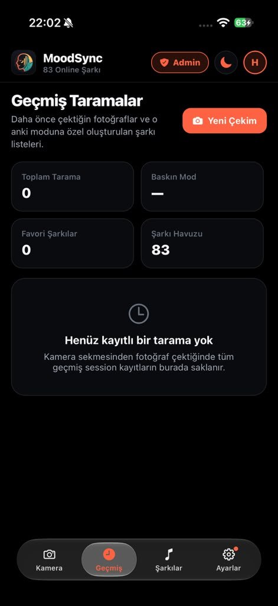
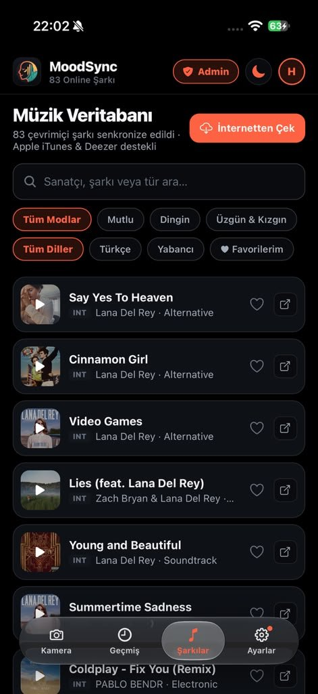
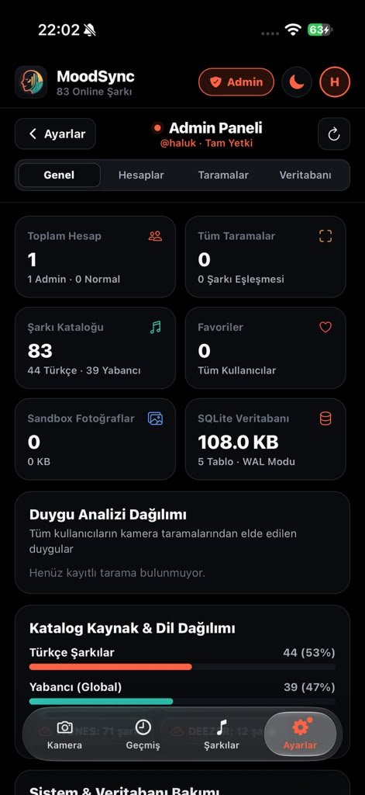

# MoodSync iOS 🎵✨

> **Tamamen Cihaz İçi Yapay Zeka (AffectNet ONNX + Apple Vision) • iOS 26/27 Liquid Glass Arayüz • Anlık Müzik Keşif Platformu**


---

## 🌟 Proje Hakkında

**MoodSync**, hiçbir harici bilgisayara veya arka plan sunucusuna ihtiyaç duymadan tamamen **iPhone üzerinde çalışan (on-device)** bir duygu analizi ve müzik öneri uygulamasıdır.

Yüz ifadenizi **AffectNet EfficientNet-B2 (ONNX)** ve **Apple Vision** motorlarıyla anında çözümler, ruh halinize en uygun Türkçe ve yabancı şarkıları **Apple iTunes** ve **Deezer** üzerinden bulur, uygulama içi **Liquid Glass Mini Oynatıcı** ile 30 saniyelik önizlemeleri çalar ve tüm geçmişinizi iPhone uygulama sandbox'ında yer alan yerel SQLite veritabanında güvenle saklar.

---

## 📱 Ekran Görüntüleri

<table>
  <tr>
    <td align="center"><b>Kamera</b></td>
    <td align="center"><b>Geçmiş</b></td>
    <td align="center"><b>Şarkılar</b></td>
    <td align="center"><b>Ayarlar</b></td>
    <td align="center"><b>Admin Paneli</b></td>
  </tr>
  <tr>
    <td></td>
    <td></td>
    <td></td>
    <td></td>
    <td></td>
  </tr>
</table>

---

## ✨ Neler Yapabilirsin?

### 🧊 iOS 26/27 Native Liquid Glass Deneyimi (120Hz ProMotion)
- **Native Liquid Glass Tab Bar (`MoodSyncLiquidTabBarView`):** `UIGlassEffect` + `CADisplayLink` 120Hz yay fiziği, tek katmanlı akışkan cam balon, kısmi renk maskeleme (`CAShapeLayer`), prizmatik kenar parıltısı ve hem dokunarak hem basılı tutup kaydırarak pürüzsüz sekme geçişi.
- **Liquid Glass Mini Audio Player:** Alttaki sekme çubuğuyla uyumlu yüzen kapsül oynatıcı, canlı ekolayzır çubukları, şarkı ilerleme göstergesi, sonraki parçaya geçiş ve tek dokunuşla çal/duraklat.
- **Dark & Tinted Ana Ekran İkonları:** iOS Karanlık Mod ve Renklendirilmiş (Tinted) Ana Ekran simgeleri + uygulama içi dinamik koyu/açık tema logosu.
- **4 Tema Seçeneği:** OLED Simsiyah (`#000000`), Obsidyen Karbon, Gece Mavisi ve Aydınlık tema.

### 📸 Gizlilik Odaklı İsteğe Bağlı Kamera & Anında Çekim
- **Sürekli Açık Kalmayan Kamera:** Ana sayfa açıldığında kamera varsayılan olarak kapalıdır; yalnızca **Kamerayı Başlat** tuşuna bastığında açılır.
- **Akıllı Otomatik Kapanma:** Fotoğraf çekildiğinde, başka sekmeye geçildiğinde, uygulama arka plana alındığında veya 45 saniye işlem yapılmadığında pil ve gizlilik için kamera otomatik kapanır.
- **Beklemeden Çekim & Arka Plan Analizi:** Canlı yüz algılamasını beklemeden kamerayı açar açmaz fotoğraf çekebilirsin; kamera hemen kapanır, duygu analizi ve şarkı listesi arka planda tamamlanır.
- **Galeriden Fotoğraf Analizi:** İstersen kamerayı hiç açmadan iPhone fotoğraf arşivinden görsel seçerek analiz edebilirsin.

### 🎭 5 Duygu Durumu & Akıllı Müzik Keşfi
- 🟠 **Mutlu (Happy)** · 🟣 **Heyecanlı (Surprise)** · 🟢 **Dingin (Neutral)** · 🔵 **Üzgün (Sad)** · 🔴 **Kızgın (Angry)**
- **Şarkıları Kalıcı Olarak Genişletme (`+5` / `+10` / `+15`):** Hem aktif taramada hem geçmiş taramalarda şarkı sayısını sonradan istediğin kadar artırabilir, yeni keşfedilen şarkıları SQLite oturumuna kalıcı olarak kaydedebilirsin.
- **Şarkılar Kütüphanesi:** Mod, dil (`Türkçe` / `Yabancı`), favoriler ve anlık arama filtreleri ile yerel + çevrimiçi kataloğu yönetme.

### 🕒 Geçmiş Taramalar & Özel Tarama Detayı (`ScanDetailScreen`)
- Geçmiş sekmesindeki herhangi bir fotoğrafa veya karta dokunduğunda kameraya geri dönmeden o taramaya özel **Tarama Detayı** ekranı açılır.
- Çekilen fotoğrafı tam ekran inceleyebilir, o anki duygu/güven skorunu görebilir, şarkıları dinleyip favorileyebilir ve `+5 / +10 / +15` seçenekleriyle listeyi genişletebilirsin.

### 🛡️ Ayarlar & Admin Paneli (SQLite Gezgini)
- **Ayarlar Sekmesi:** Tema seçimi, gizlilik & depolama özeti, geçmişi temizleme ve güvenli çıkış.
- **Rol Tabanlı Yetkilendirme:** `haluk` hesabı otomatik `admin` rolüne sahiptir; yeni oluşturulan tüm hesaplar standart `user` olarak çalışır.
- **Admin Paneli (`AdminPanelScreen`):**
  - Veritabanı genel istatistikleri ve depolama temizliği (sahipsiz fotoğraf temizleyici)
  - Kullanıcı yönetimi (hesap oluşturma, şifre sıfırlama, hesap silme)
  - Tüm kullanıcıların tarama oturumlarını filtreleme ve inceleme
  - Canlı **SQLite Tablo Gezgini** ve **Salt-Okunur SQL Sorgu Konsolu** (`SELECT`, `PRAGMA`, `EXPLAIN`)

---

## 🏗️ Proje Yapısı

```text
MoodSync-iOS-Project/
├── mobile/                                 # Standalone Native iOS Uygulaması (Expo / React Native)
│   ├── App.tsx                             # Ana navigasyon, ses kuyruğu ve oturum yönetimi
│   ├── modules/moodsync-vision/            # Native Swift iOS Modülü
│   │   ├── ios/MoodSyncVisionModule.swift  # AffectNet ONNX, Apple Vision, UIGlassEffect & 120Hz TabBar
│   │   └── index.ts                        # JS/TS köprüsü
│   ├── src/
│   │   ├── screens/
│   │   │   ├── CameraStudioScreen.tsx      # İsteğe bağlı kamera, anında çekim & arka plan analizi
│   │   │   ├── HistoryScreen.tsx           # Geçmiş taramalar listesi
│   │   │   ├── ScanDetailScreen.tsx        # Geçmiş taramaya özel detay & şarkı genişletme ekranı
│   │   │   ├── LibraryScreen.tsx           # Müzik veritabanı, filtreleme ve çevrimiçi çekim
│   │   │   ├── SettingsScreen.tsx          # Tema, gizlilik, depolama ve hesap ayarları
│   │   │   ├── AdminPanelScreen.tsx        # Admin paneli, kullanıcı yönetimi & SQL konsolu
│   │   │   └── LoginScreen.tsx             # Giriş ve kayıt ekranı
│   │   ├── components/
│   │   │   ├── LiquidGlassTabBar.tsx       # Native iOS 26/27 Liquid Glass alt sekme çubuğu
│   │   │   ├── LiquidGlassSurface.tsx      # Native UIGlassEffect sarmalayıcısı
│   │   │   ├── MiniAudioPlayer.tsx         # Liquid Glass kapsül müzik çalar
│   │   │   ├── MotionPrimitives.tsx        # Yay animasyonları ve geçiş bileşenleri
│   │   │   └── TrackRow.tsx                # Şarkı satırı & kademeli giriş animasyonu
│   │   ├── database/iosDatabase.ts         # Yerel SQLite şeması, oturum & admin API'leri
│   │   └── services/                       # moodAiService & onlineMusicService (iTunes/Deezer)
│   └── ios/MoodSync.xcworkspace            # Xcode iOS projesi
├── CHANGELOG.md                            # Sürüm geçmişi ve detaylı değişiklik notları
└── README.md
```

---

## 🛠️ Xcode ile iPhone'a Kurulum

1. Depoyu klonlayın ve bağımlılıkları yükleyin:
   ```bash
   git clone https://github.com/justlacia/MoodSync-iOS-Project.git
   cd MoodSync-iOS-Project/mobile
   npm install
   ```
2. Xcode çalışma alanını açın:
   ```bash
   open ios/MoodSync.xcworkspace
   ```
3. Xcode'da **Signing & Capabilities** bölümünden kendi Apple Developer hesabınızı seçin, iPhone'unuzu bağlayın ve **Run (`⌘R`)** ile cihazınıza yükleyin.

---

## 📌 Sürüm Geçmişi

Tüm sürümler ve detaylı değişiklik kayıtları için [CHANGELOG.md](CHANGELOG.md) dosyasına göz atabilirsiniz.

- **`v2.1.0`** — CoreML / Apple Neural Engine (ANE) ONNX hızlandırma, baş hizalama (`roll`), adaptif ışık dengelemesi, son çekimde yatay ayna TTA ve legacy YOLO/backend dosyalarının temizlenip saf iOS deposuna geçiş.
- **`v2.0.0`** — iOS 26/27 Native Liquid Glass Tab Bar & Mini Player, Admin Paneli & SQLite Gezgini, Ayarlar Sekmesi, Özel Tarama Detayı (`ScanDetailScreen`), Kalıcı Şarkı Genişletme (`+5/+10/+15`), Gizlilik Odaklı İsteğe Bağlı Kamera & Anında Çekim, Dark/Tinted Ana Ekran İkonları.

---

## 📄 Lisans

Bu proje [MIT Lisansı](LICENSE) altında lisanslanmıştır.
