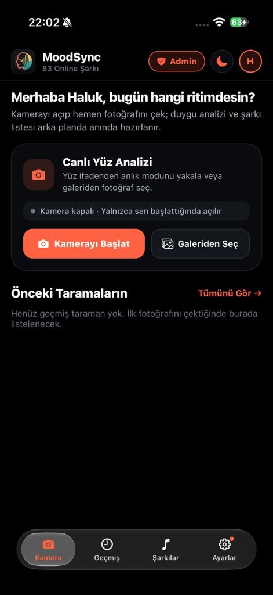
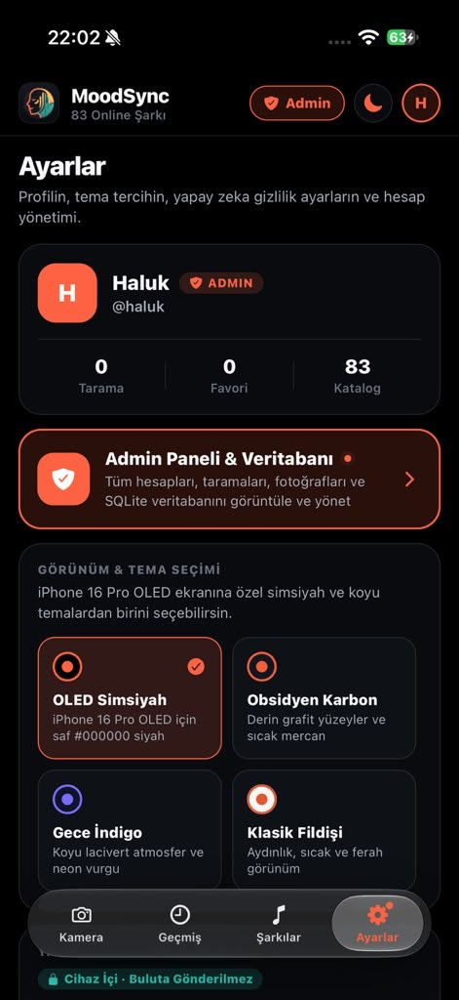

# MoodSync iOS & Cloud Platform 🎵☁️✨

> **Cihaz İçi Yapay Zeka (AffectNet ONNX + Apple Vision) • Azure Bulut (PostgreSQL + Private Blob) • Görsel Web & Admin Portalı • iOS 26/27 Liquid Glass**


---

## 🌟 Proje Hakkında / About the Project

**🇹🇷 Türkçe:** **MoodSync**, yüz ifadesi analizini tamamen **iPhone üzerinde (on-device)** **AffectNet EfficientNet-B2 (ONNX)** ve **Apple Vision** motorlarıyla gerçekleştiren, tüm verilerini ve **3.055+ şarkılık kürasyonlu müzik kataloğunu** ise **Azure Bulut** (`Azure App Service` + `PostgreSQL Flexible Server` + imzalı SAS URL korumalı özel `Azure Blob Storage`) üzerinde senkronize eden hibrit bir müzik keşif platformudur. Uygulamaya ek olarak tarayıcıdan erişilebilen modern **Web & Görsel Admin Portalı** ile telefon olmadan da tüm taramalar, Blob fotoğraflar, 10 PostgreSQL tablosu ve şarkı oynatıcısı yönetilebilir.

**🇬🇧 English:** **MoodSync** is a hybrid emotion-aware music discovery platform that runs facial expression inference **on-device on iPhone** (**AffectNet EfficientNet-B2 ONNX + Apple Vision**) while synchronizing accounts, biometric Face ID tokens, scan histories, private SAS-protected snapshots, playlists, and a **3,055+ curated song catalog** on **Azure Cloud** (`App Service` + `PostgreSQL` + `Private Blob Storage`). It also includes a built-in **Web & Visual Admin Portal** accessible from any browser for inspecting scans, Blob photos, all 10 PostgreSQL tables, and streaming previews.

---

## 📱 Ekran Görüntüleri

<table>
  <tr>
    <td align="center"><b>Kamera</b></td>
    <td align="center"><b>Geçmiş</b></td>
    <td align="center"><b>Şarkılar</b></td>
    <td align="center"><b>Ayarlar</b></td>
    <td align="center"><b>Admin Paneli</b></td>
  </tr>
  <tr>
    <td></td>
    <td></td>
    <td></td>
    <td></td>
    <td></td>
  </tr>
</table>

---

## ✨ Neler Yapabilirsin?

### 🧊 iOS 26/27 Native Liquid Glass Deneyimi (120Hz ProMotion)
- **Native Liquid Glass Tab Bar (`MoodSyncLiquidTabBarView`):** `UIGlassEffect` + `CADisplayLink` 120Hz yay fiziği, tek katmanlı akışkan cam balon, kısmi renk maskeleme (`CAShapeLayer`), prizmatik kenar parıltısı ve hem dokunarak hem basılı tutup kaydırarak pürüzsüz sekme geçişi.
- **Liquid Glass Mini Audio Player:** Alttaki sekme çubuğuyla uyumlu yüzen kapsül oynatıcı, canlı ekolayzır çubukları, şarkı ilerleme göstergesi, sonraki parçaya geçiş ve tek dokunuşla çal/duraklat.
- **Dark & Tinted Ana Ekran İkonları:** iOS Karanlık Mod ve Renklendirilmiş (Tinted) Ana Ekran simgeleri + uygulama içi dinamik koyu/açık tema logosu.
- **4 Tema Seçeneği:** OLED Simsiyah (`#000000`), Obsidyen Karbon, Gece Mavisi ve Aydınlık tema.

### 📸 Gizlilik Odaklı İsteğe Bağlı Kamera & Anında Çekim
- **Sürekli Açık Kalmayan Kamera:** Ana sayfa açıldığında kamera varsayılan olarak kapalıdır; yalnızca **Kamerayı Başlat** tuşuna bastığında açılır.
- **Akıllı Otomatik Kapanma:** Fotoğraf çekildiğinde, başka sekmeye geçildiğinde, uygulama arka plana alındığında veya 45 saniye işlem yapılmadığında pil ve gizlilik için kamera otomatik kapanır.
- **Beklemeden Çekim & Arka Plan Analizi:** Canlı yüz algılamasını beklemeden kamerayı açar açmaz fotoğraf çekebilirsin; kamera hemen kapanır, duygu analizi ve şarkı listesi arka planda tamamlanır.
- **Galeriden Fotoğraf Analizi:** İstersen kamerayı hiç açmadan iPhone fotoğraf arşivinden görsel seçerek analiz edebilirsin.

### 🎭 5 Duygu Durumu & Akıllı Müzik Keşfi
- 🟠 **Mutlu (Happy)** · 🟣 **Heyecanlı (Surprise)** · 🟢 **Dingin (Neutral)** · 🔵 **Üzgün (Sad)** · 🔴 **Kızgın (Angry)**
- **Şarkıları Kalıcı Olarak Genişletme (`+5` / `+10` / `+15`):** Hem aktif taramada hem geçmiş taramalarda şarkı sayısını sonradan istediğin kadar artırabilir, yeni keşfedilen şarkıları SQLite oturumuna kalıcı olarak kaydedebilirsin.
- **Şarkılar Kütüphanesi:** Mod, dil (`Türkçe` / `Yabancı`), favoriler ve anlık arama filtreleri ile yerel + çevrimiçi kataloğu yönetme.

### 🕒 Geçmiş Taramalar & Özel Tarama Detayı (`ScanDetailScreen`)
- Geçmiş sekmesindeki herhangi bir fotoğrafa veya karta dokunduğunda kameraya geri dönmeden o taramaya özel **Tarama Detayı** ekranı açılır.
- Çekilen fotoğrafı tam ekran inceleyebilir, o anki duygu/güven skorunu görebilir, şarkıları dinleyip favorileyebilir ve `+5 / +10 / +15` seçenekleriyle listeyi genişletebilirsin.

### 🛡️ Ayarlar & Admin Paneli (`SettingsScreen`, `AdminPanelScreen`)
- **Ayarlar Sekmesi:** Tema seçimi, Face ID biyometrik eşleştirme yönetimi, gizlilik & bulut depolama özeti, "Bir Daha Önerme" listesi ve güvenli çıkış.
- **Rol Tabanlı Yetkilendirme:** `haluk` hesabı otomatik `admin` rolüne sahiptir; yeni oluşturulan tüm hesaplar standart `user` olarak çalışır.
- **Admin Paneli:** Bulut veritabanı genel istatistikleri, yetim Blob temizliği, kullanıcı yönetimi, tarama oturumu inceleme ve PostgreSQL tablo/SQL araçları.

### 🌐 Web & Görsel Admin Portalı (`cloud-api/public/`)
- **Tarayıcıdan Erişim (`/` ve `/admin`):** OLED Koyu & Aydınlık Liquid Glass temalı responsive web portalı ile telefon olmadan da tüm verilere erişim (`https://moodsync-api-haluk.azurewebsites.net`).
- **Kişisel Web Alanı:** **Taramalarım** (imzalı SAS URL ile gizli Blob fotoğraflar ve günlük notları), **Şarkılar** (3.055+ kürasyonlu şarkı kataloğunda arama, sayfalama, filtreleme) ve **Listelerim**.
- **Sıfır-SQL Görsel Admin:** **Genel Bakış**, **Hesaplar**, **Tüm Taramalar**, Lightbox büyütmeli **Fotoğraf Galerisi (Blob)** ve hassas hash sütunları maskelenmiş Excel benzeri **10 Tablo Gezgini** (+ isteğe bağlı salt-okunur SQL çekmecesi).
- **Web Ses Oynatıcısı:** `%0–%100` ses seviyesi kaydırıcısı (`localStorage` kalıcılığı), dinamik ikonlu sessize alma (`M`), fare tekerleğiyle `%5` ses adımı, tekrar çalma (`🔁`) ve `Space` ile oynat/duraklat.

---

## 🏗️ Proje Yapısı / Project Structure

```text
MoodSync-iOS-Project/
├── cloud-api/                              # Azure Cloud API & Web Portalı (Node.js / Express / TypeScript)
│   ├── public/                             # Responsive Web & Görsel Admin Portalı (index.html, styles.css, app.js)
│   └── src/
│       ├── server.ts                       # Auth, Scan, Catalog, Playlist, Admin Table/Blob & Bulk PATCH API'leri
│       ├── db.ts                           # Azure PostgreSQL 10 tablo şeması & eşleyiciler
│       ├── blobStorage.ts                  # Private Azure Blob Storage ('snapshots') & 24h SAS URL üretimi
│       ├── musicCatalog.ts                 # 3.055+ kürasyonlu Türkçe/Global katalog, junk filtre & öneri motoru
│       ├── auth.ts                         # JWT & rol tabanlı yetkilendirme middleware'leri
│       └── seedCatalogCli.ts               # Katalog tohumlama CLI aracı
├── mobile/                                 # Native iOS Uygulaması (Expo / React Native + Swift)
│   ├── App.tsx                             # Ana navigasyon, bulut senkronizasyonu & ses kuyruğu
│   ├── modules/moodsync-vision/            # Native Swift iOS Modülü
│   │   ├── ios/MoodSyncVisionModule.swift  # AffectNet ONNX, Apple Vision, UIGlassEffect, Face ID & 120Hz TabBar
│   │   └── index.ts                        # JS/TS köprüsü
│   ├── src/
│   │   ├── config/cloudConfig.ts           # Azure Cloud API temel URL ve zaman aşımı ayarları
│   │   ├── services/cloudApi.ts            # REST API istemcisi (JWT, tarama yükleme, katalog & admin)
│   │   ├── screens/
│   │   │   ├── CameraStudioScreen.tsx      # İsteğe bağlı kamera, anında çekim & arka plan analizi
│   │   │   ├── HistoryScreen.tsx           # Geçmiş taramalar listesi
│   │   │   ├── ScanDetailScreen.tsx        # Geçmiş taramaya özel detay & şarkı genişletme ekranı
│   │   │   ├── LibraryScreen.tsx           # Müzik veritabanı, filtreleme ve çevrimiçi çekim
│   │   │   ├── SettingsScreen.tsx          # Tema, Face ID güvenliği, gizlilik & hesap ayarları
│   │   │   ├── AdminPanelScreen.tsx        # Admin paneli, kullanıcı yönetimi & SQL konsolu
│   │   │   └── LoginScreen.tsx             # Giriş, kayıt ve Face ID biyometrik giriş
│   │   ├── components/
│   │   │   ├── LiquidGlassTabBar.tsx       # Native iOS 26/27 Liquid Glass alt sekme çubuğu
│   │   │   ├── LiquidGlassSurface.tsx      # Native UIGlassEffect sarmalayıcısı
│   │   │   ├── ExpandableAudioPlayer.tsx   # Tek kapsül morph mini & tam ekran müzik çalar
│   │   │   ├── MotionPrimitives.tsx        # Yay animasyonları ve geçiş bileşenleri
│   │   │   └── TrackRow.tsx                # Şarkı satırı & kademeli giriş animasyonu
│   │   ├── database/iosDatabase.ts         # Bulut senkronizasyonlu veri katmanı & Keychain Face ID köprüsü
│   │   └── services/                       # moodAiService & onlineMusicService
│   └── ios/MoodSync.xcworkspace            # Xcode iOS projesi
├── CHANGELOG.md                            # Sürüm geçmişi (TR / EN)
└── README.md
```

---

## 🛠️ Xcode ile iPhone'a Kurulum

1. Depoyu klonlayın ve bağımlılıkları yükleyin:
   ```bash
   git clone https://github.com/justlacia/MoodSync-iOS-Project.git
   cd MoodSync-iOS-Project/mobile
   npm install
   ```
2. Xcode çalışma alanını açın:
   ```bash
   open ios/MoodSync.xcworkspace
   ```
3. Xcode'da **Signing & Capabilities** bölümünden kendi Apple Developer hesabınızı seçin, iPhone'unuzu bağlayın ve **Run (`⌘R`)** ile cihazınıza yükleyin.

---

## 📌 Sürüm Geçmişi / Release History

Tüm sürümler ve Türkçe + İngilizce detaylı değişiklik kayıtları için [CHANGELOG.md](CHANGELOG.md) dosyasına göz atabilirsiniz.

- **`v3.0.0`** — Azure Cloud Backend (`App Service` + `PostgreSQL` + `Private Blob SAS`), Responsive Web & Görsel Admin Portalı, ses/tekrar/kısayol kontrollü Web Oynatıcı, **3.055+ kürasyonlu şarkı kataloğu** (822 duygu düzeltmesi + 74 kirlilik temizliği) ve tam iOS bulut senkronizasyonu.
- **`v2.2.0`** — Genişleyebilir Liquid Glass Mini & Tam Ekran Oynatıcı, hesaba bağlı Keychain Face ID, Özel Çalma Listeleri, Mod Stratejisi, Tarama Günlüğü, katı TR/Yabancı ayrımı ve animasyon iyileştirmeleri.
- **`v2.1.0`** — CoreML / Apple Neural Engine (ANE) ONNX hızlandırma, baş hizalama (`roll`), adaptif ışık dengelemesi, son çekimde yatay ayna TTA ve legacy YOLO/backend dosyalarının temizlenip saf iOS deposuna geçiş.
- **`v2.0.0`** — iOS 26/27 Native Liquid Glass Tab Bar & Mini Player, Admin Paneli & SQLite Gezgini, Ayarlar Sekmesi, Özel Tarama Detayı (`ScanDetailScreen`), Kalıcı Şarkı Genişletme (`+5/+10/+15`), Gizlilik Odaklı İsteğe Bağlı Kamera & Anında Çekim, Dark/Tinted Ana Ekran İkonları.

---

## 📄 Lisans

Bu proje [MIT Lisansı](LICENSE) altında lisanslanmıştır.
