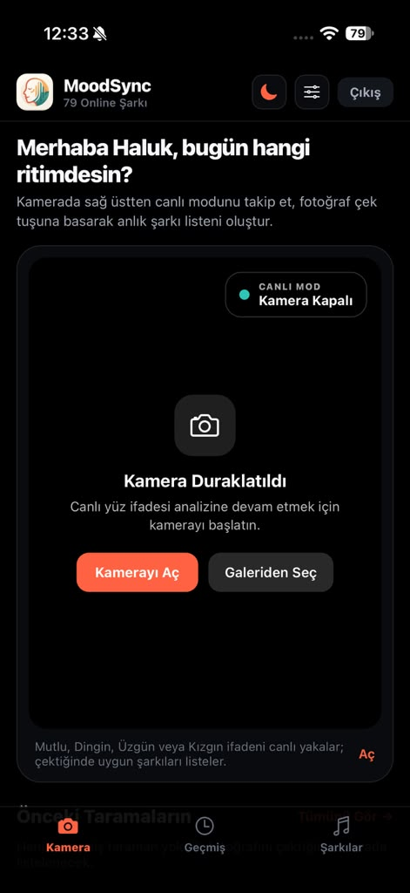
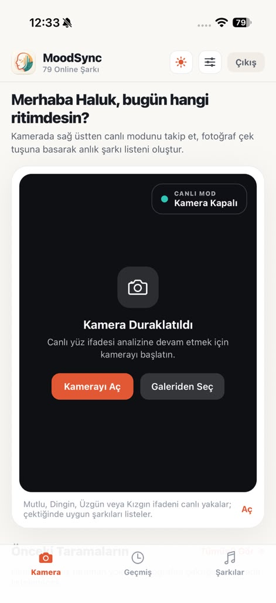

# MoodSync iOS Uygulaması (React Native & Expo SDK 58)

<p align="center">
  
  &nbsp;&nbsp;
  
</p>

**iPhone 16 Pro** ve tüm iOS cihazlar için geliştirilmiş, cihaz içi **On-Device AffectNet ONNX (`MoodSyncVision`)** duygu analizi motoru, **SQLite (`expo-sqlite`)** veritabanı, **644+ çevrimiçi şarkı kataloğu**, canlı **Apple iTunes & Deezer API** entegrasyonu ve **native iOS Kamera (`expo-camera`)** sağ üst mod göstergesine sahip native iOS uygulaması.

## iPhone 16 Pro'da Çalıştırma (Mac / Xcode Bağımsız Kurulum veya Expo)

### 1. Bilgisayardan %100 Bağımsız (Standalone Native iOS) Kurulum
```bash
cd mobile
npm install
npx pod-install
open ios/MoodSync.xcworkspace
```
Xcode üzerinden **Product > Scheme > Edit Scheme > Run > Build Configuration: Release** seçip iPhone 16 Pro cihazınıza yüklediğinizde uygulama hiçbir bilgisayar veya sunucuya ihtiyaç duymadan tamamen telefon işlemcisi üzerinde çalışır.

### 2. Yerel Ağ / Geliştirici Modu ile Çalıştırma
```bash
python start_ios.py
```

## Uygulama İçi Akış

- **Animasyonlu Açılış & 4 Özel Tema:** 120Hz ProMotion uyumlu özel MoodSync logosu, **OLED Simsiyah (`#000000`)**, **Obsidyen Karbon**, **Gece İndigo** ve **Klasik Fildişi** temaları.
- **Güvenli Cihaz İçi Giriş / Kayıt:** Cihaz içi SQLite `users` tablosunda `SHA-256` ile özetlenmiş kullanıcı hesabı yönetimi.
- **Canlı Kamera & Sağ Üst Mod Göstergesi:** Ön/arka kamera desteği, ayna görüntüsü (mirror) koruması, sağ üstte gerçek zamanlı mod rozeti (`Mutlu`, `Heyecanlı`, `Dingin`, `Üzgün`, `Kızgın` + güven yüzdesi) ve yüz takip kadrajı.
- **Fotoğraf Çek & Kademeli (Cascade) Müzik Önerisi:** Deklanşöre basıldığında çekilen kare yumuşak bir geçişle aşağı kayar ve o anki moduna uygun 16 şarkılık liste yukarıdan aşağıya tek tek animasyonla sıralanır; 30 saniyelik native ses önizlemesi (`expo-audio` — sessiz modda bile çalar) sunar ve uygulama içi korumalı sandbox'a kaydeder.
